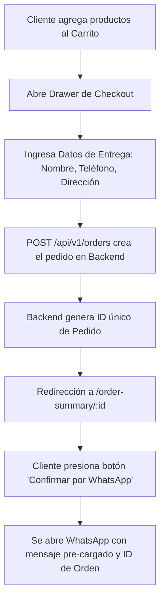

# 🛍️ Guía Integral y Arquitectura de la Tienda (Storefront)

Bienvenido a la documentación técnica y operativa del frontend de comercio electrónico para clientes finales (**LBM - La Barata Mayoreos**). Esta aplicación está construida sobre **Next.js (App Router)** y diseñada con un enfoque de alto rendimiento, micro-interacciones fluidas y un embudo de conversión optimizado para ventas por mayoreo en México.

---

## 📌 1. Arquitectura General y Tecnologías

El storefront opera de forma desacoplada consumiendo la API REST del backend alojado en Render.

* **Framework Base:** [Next.js](https://nextjs.org/) (v13.5.6 con App Router).
* **Tipado Estricto:** [TypeScript](https://www.typescriptlang.org/) v5.
* **Diseño y Estilos:** [Tailwind CSS](https://tailwindcss.com/) v3.3 con `@tailwindcss/typography` y utilidades personalizadas.
* **Estado Global de Carrito:** [Zustand](https://github.com/pmndrs/zustand) con persistencia automática en `localStorage` (`cart-storage`).
* **Micro-Animaciones:** `framer-motion` y componentes accesibles de `@headlessui/react`.
* **Cierre de Ventas / Checkout:** Creación de orden en el Backend e integración con enlace dinámico a **WhatsApp Business**.

---

## ⚙️ 2. Variables de Entorno y Configuración

Crea o verifica el archivo `.env.local` en la raíz de `store/`:

```env
# URL base de la API REST del Backend (Render o Local)
NEXT_PUBLIC_API_URL=https://tribuna-back-nfl9.onrender.com/api/v1

# Identidad y Metadatos de la Tienda
SITE_NAME="LBM - La Barata Mayoreos"
TWITTER_CREATOR="@lbm_mx"
TWITTER_SITE=""

# Línea de Atención para Cierre de Pedidos por WhatsApp (con lada de país)
# Formato: 52 + 10 dígitos (Ej: 523221045519)
NEXT_PUBLIC_WHATSAPP_PHONE=523221045519
```

---

## 🧮 3. Motor de Precios y Regla de Negocio Mayoreo

La tienda implementa una lógica de precios calculada automáticamente tanto en el carrito del cliente como validada en el backend:

### Regla de Descuento 2x1000
* **Precio Unitario (1 prenda / pieza):** `$600.00 MXN`
* **Promoción por Par (2 prendas / piezas):** `$1,000.00 MXN` (ahorro de $200 MXN por par).
* **Fórmula de cálculo (`useCartStore`):**
  $$\text{Pares} = \lfloor \frac{\text{Cantidad Total}}{2} \rfloor$$
  $$\text{Sueltos} = \text{Cantidad Total} \pmod 2$$
  $$\text{Total} = (\text{Pares} \times 1000) + (\text{Sueltos} \times 600)$$

### Ejemplos de Liquidación:
* 1 artículo: $600 MXN
* 2 artículos: $1,000 MXN
* 3 artículos: $1,600 MXN (1 par + 1 suelto)
* 4 artículos: $2,000 MXN (2 pares)
* 5 artículos: $2,600 MXN (2 pares + 1 suelto)

---

## 🛒 4. Gestión del Estado: Carrito con Zustand

El estado del carrito se administra mediante el hook `useCartStore` en `stores/cartStore.ts`.

### Estructura de un Item en el Carrito:
```typescript
interface CartItem {
  productId: string; // ID único del producto en MongoDB
  name: string;      // Título comercial
  price: number;     // Precio base
  size: string;      // Talla seleccionada (S, M, L, XL, etc.)
  quantity: number;  // Unidades solicitadas
  image?: string;    // URL Cloudinary de la prenda
  slug: string;      // Slug amigable para navegación
}
```

### Métodos Disponibles:
* `addItem(item)`: Agrega una prenda o incrementa su cantidad si ya existe la combinación `(productId, size)`.
* `removeItem(productId, size)`: Elimina la línea específica del carrito.
* `updateQuantity(productId, size, quantity)`: Modifica las unidades; si `quantity <= 0`, purga el ítem.
* `clearCart()`: Limpia todo el carrito al completar una compra.
* `totalItems()`: Retorna la suma total de unidades físicas.
* `totalPrice()`: Aplica la regla mayoreo 2x1000 y retorna el importe total en MXN.

---

## 🔄 5. Flujo de Pedido y Checkout vía WhatsApp

El proceso de compra en LBM combina la formalidad de un registro en base de datos con la cercanía del comercio conversacional:



### Formato del Enlace WhatsApp:
```
https://wa.me/523221045519?text=Hola,%20mi%20pedido%20es:%20ORD-98234.%20Ya%20realicé%20mi%20orden%20y%20me%20gustaría%20confirmarla.
```

---

## 📡 6. Integración con el Backend (API Client)

La capa de datos se ubica en `lib/products.ts` y abstrae las peticiones hacia el backend:

### Obtener Catálogo de Productos
* **Función:** `getProducts({ query, reverse, sortKey })`
* **Endpoint consultado:** `GET /api/v1/products?limit=100&search=...`
* **Mapeo de Datos:** Homologa los campos del backend (`title` o `name`, `sku`, `price`, `images` en Cloudinary, `stock` y `category`).

### Búsqueda y Filtrado
Las rutas `/search` y `/search/[collection]` permiten filtrar por categoría o palabra clave sin recargar la página gracias al enrutamiento de Next.js.

---

## 🚀 7. Comandos de Desarrollo y Despliegue

| Comando | Acción |
| :--- | :--- |
| `pnpm dev` | Inicia el servidor de desarrollo en `http://localhost:3000` |
| `pnpm build` | Compila la aplicación para producción (TypeScript check + Next.js build) |
| `pnpm start` | Inicia el servidor optimizado de producción |
| `pnpm lint` | Inspecciona el código con ESLint |

---

## 🛡️ 8. Buenas Prácticas y Notas Técnicas

> [!TIP]
> **Optimización de Imágenes con Cloudinary:** Next.js utiliza `next/image` para renderizar imágenes de alta fidelidad. Asegúrate de que el dominio `res.cloudinary.com` esté configurado en `images.domains` dentro de `next.config.js`.

> [!IMPORTANT]
> **Consistencia de Precios:** El frontend nunca debe forzar precios arbitrarios sin respaldo. Cuando se envía el pedido al backend, este vuelve a calcular la regla de 2x1000 en el servidor (`order.Controller.js`) para garantizar que no existan manipulaciones en el cliente.

---

## 📲 9. Generador de Enlace y Pedido WhatsApp (`lib/whatsapp.ts`)

El archivo `store/lib/whatsapp.ts` exporta la función tipada `generateWhatsAppOrderUrl` para estructurar carritos con variantes y datos de envío:

```typescript
import { generateWhatsAppOrderUrl } from 'lib/whatsapp';

const waUrl = generateWhatsAppOrderUrl(
  "5213111234567",
  "La Barata Mayoreos",
  "MXN",
  [
    {
      name: "Playera Polo Dry-Fit",
      variant: { size: "G", color: "Negro" },
      quantity: 2,
      unitPrice: 500
    }
  ],
  {
    name: "Juan Pérez",
    address: "Av. México #123, Tepic, Nayarit",
    notes: "Entregar por la tarde"
  }
);
```

---

## 🚫 10. Pantalla de Suspensión Amigable (`StoreSuspended.tsx`)

Cuando el backend responde con código `403` y error `STORE_SUSPENDED` (tienda inactiva o suscripción vencida), el storefront renderiza el componente `store/components/StoreSuspended.tsx`:
* Muestra el mensaje: *"Catálogo en Mantenimiento Temporal"*.
* Explica con claridad y cortesía que la tienda se encuentra en pausa o actualizando su inventario.
* Ofrece un botón de contacto directo a WhatsApp al equipo de soporte o administrador para aclaraciones inmediatas.

